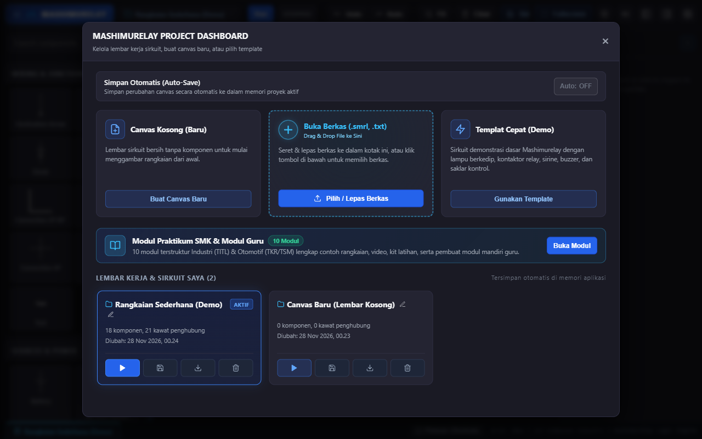

<p align="center">
  <a href="https://github.com/maulana-mash/Mashimurelay.exe">
    
  </a>
</p>

<h1 align="center">Mashimurelay Windows Desktop</h1>

<p align="center">
  <strong>Simulator CAD Relay Elektromekanikal &amp; Kontrol Motor Industri Native Windows (Rust + Tauri v2)</strong><br />
  Stasiun kerja instruktur dan teknisi berstandar IEC 60617 dengan jejak memori ultra-ringan (~35 MB RAM), 117 simbol vektor industri, serta microserver Hotspot LAN 100% offline untuk praktikum dan ujian kelas.
</p>

<p align="center">
  <a href="https://github.com/maulana-mash/Mashimurelay.exe/releases">
    
  </a>
  
  
  
  
</p>

<p align="center">
  <a href="#pratinjau-antarmuka">Pratinjau</a> &bull;
  <a href="#arsitektur-teknis--fitur-unggulan">Fitur Unggulan</a> &bull;
  <a href="#pustaka-komponen-standar-iec-60617-117-simbol-industri">117 Komponen</a> &bull;
  <a href="#unduhan--opsi-distribusi-windows">Unduhan</a> &bull;
  <a href="#kompilasi-dari-kode-sumber">Kompilasi</a> &bull;
  <a href="#lisensi--hak-cipta">Lisensi</a>
</p>

---

## Pratinjau Antarmuka

<p align="center">
  
</p>

<p align="center">
  <sub>Tampilan Mashimurelay Project Dashboard: manajemen lembar kerja `.smrl`, 10 modul praktikum SMK &amp; modul guru, templat cepat demo, dan autosave.</sub>
</p>

---

## Ringkasan Proyek

**Mashimurelay Windows** (`com.mashimurelay.cad`) adalah aplikasi Computer-Aided Design (CAD) dan simulator interaktif waktu nyata (*real-time*) untuk perancangan skematik rangkaian kontrol relay elektromekanikal serta sistem tenaga motor listrik industri berstandar **IEC 60617**.

Dibangun menggunakan arsitektur **Hybrid Native Desktop** berbasis **Rust (Tauri v2)** dan akselerasi grafis WebView2, aplikasi ini beroperasi dengan jejak memori hanya ~35–50 MB RAM, mendukung refresh rate 60–144 FPS, serta dibekali **Local Classroom Hotspot Server** untuk mendistribusikan soal dan mengumpulkan tugas siswa secara nirkabel **100% Offline LAN**.

---

## Arsitektur Teknis & Fitur Unggulan

1. **Rust Tauri v2 Native Core & Asosiasi Berkas Windows:**
   - Menggunakan WebView2 bawaan Windows (~35 MB RAM), komunikasi IPC Rust berkecepatan tinggi, serta pendaftaran asosiasi berkas `.smrl` dan `.srelay` langsung di Windows Explorer.
2. **Local Classroom Hotspot Server (100% Offline LAN Microserver):**
   - Server HTTP multi-thread internal Rust (`std::net::TcpListener`, port `8765`) dengan pembuatan QR alamat lokal otomatis. Siswa memindai QR lewat [Mashimurelay Android](https://github.com/maulana-mash/Mashimurelay.apk) (`GET /task.smrl`) dan guru dapat menguji rangkaian kiriman siswa dalam satu klik.
3. **Mode Kelas Hibrida — Praktikum vs. Ujian:**
   - **Mode Praktikum:** Bebas revisi dengan pelacakan lencana (`Revisi 2`, `Revisi 3`) dan urutan kedatangan pertama (`#1 Tercepat`).
   - **Mode Ujian:** Mengunci pengumpulan maksimal satu kali per perangkat; pengiriman ulang ditolak dengan respons **HTTP 403 Forbidden**.
4. **Native Folder Picker (`rfd::FileDialogBuilder`):**
   - Memilih folder penyimpanan tugas siswa langsung lewat dialog Windows dan membuka arsip di File Explorer dalam satu klik.
5. **Discrete-Event Equipotential Circuit Solver:**
   - Propagasi multi-rail (`L1`, `L2`, `L3`, `N`, `PE`, `DC+`, `DC-`) via BFS, resolusi beban seri/paralel dan dioda via DFS, konvergensi *fixed-point* deterministik, serta proteksi hubung singkat, peleburan sekring, dan *Thermal Overload Relay*.
6. **Hardware-Accelerated 2D Canvas, Web Audio API & Laporan PDF Etiket Teknik:**
   - Navigasi kanvas 60–144 Hz, sintesis suara elektromekanis (*contactor*, *motor hum*, *breaker trip*, *alarm bell*) tanpa berkas audio eksternal, dan ekspor PDF 2 halaman lengkap dengan etiket gambar teknik serta *Bill of Materials* (BOM).

---

## Pustaka Komponen Standar IEC 60617 (117 Simbol Industri)

| Kategori | Cakupan Komponen Utama |
| :--- | :--- |
| **Sources** | Suplai Fasa Tunggal (`L1`), 3-Fasa (`L1, L2, L3`, `3P`, `3P+N`), Netral (`N`), Ground Proteksi (`PE`), Suplai DC (`+`, `-`, Battery), Power Supply AC/DC (1P & 3P), Generator 3-Fasa (Manual & Auto Control `C1-C2`). |
| **Protections** | MCB / Circuit Breaker (1P–4P), Thermal-Magnetic Breaker, MPCB, RCCB, RCBO, Fuse (1P–3P + N), Fuse Disconnector, Isolator Switch, Thermal Overload Relay (TOR) 1P–3P dengan fitur *Test-Trip*. |
| **Switches** | Saklar Manual (`NO`, `NC`, `CON`), Saklar Selektor 3-Posisi (`I-0-II`, `I-II-III`), Pushbutton (`NO`, `NC`, `CON`, `NONC`, `Crossover`), Emergency Stop, Limit, Roller, Foot Pedal, Key, Pressure, Temperature, Float, Flow, & Proximity Sensor. |
| **Contactors** | Kontaktor Daya Utama `NO` dan `NC` (1P hingga 4P) tersinkronisasi otomatis dengan koil kendali (`-KM`). |
| **Coils & Timers** | Koil Kontaktor Standar, Latching Relay, Solenoid, On-Delay Timer (`KT`), Off-Delay Timer, On-Off Delay Timer, Flasher/Blinker Relay, dan Phase Failure Relay (`PFR`). |
| **Auxiliaries** | Kontak Bantu Instan (`NO`, `NC`, `CON`, `NONC`), Kontak Bantu Tunda Waktu (*On-Delay*, *Off-Delay*, *On-Off Delay*), serta Kontak Bantu *Thermal Overload* (`95-96` NC & `97-98` NO). |
| **Motors** | Motor Induksi 3-Fasa (`U1, V1, W1`), Motor 3-Fasa 6-Terminal *Star-Delta* (`U1..W2`), Motor Dahlander 2-Kecepatan, Motor 2-Belitan Terpisah, Motor Induksi 1-Fasa, dan Motor DC (CW/CCW). |
| **Loads** | Lampu Indikator 5 warna, Lampu Kedip, Buzzer, Siren, dan Industrial Bell dengan sintesis audio waktu nyata. |
| **Others** | Terminal Block, Junction Node, Cross-Reference Arrows (`-REF1`), Dioda Penyearah, dan Anotasi Teks CAD. |

---

## Ekosistem Tiga Platform Terintegrasi

Format berkas proyek Mashimurelay (`.smrl` / `.srelay`) kompatibel penuh antar-platform:

1. **[Mashimurelay Windows Desktop](https://github.com/maulana-mash/Mashimurelay.exe)** (`Rust Tauri v2 Desktop`) — **Repositori ini.**
2. **[Mashimurelay Web](https://github.com/maulana-mash/Mashimurelay.web)** (`PWA & Online Simulator`) — Berjalan di peramban modern dengan *offline-first* Service Worker.
3. **[Mashimurelay Android](https://github.com/maulana-mash/Mashimurelay.apk)** (`100% Pure Kotlin Native`) — Aplikasi mobile native GPU Canvas untuk perangkat siswa di kelas.

---

## Unduhan & Opsi Distribusi Windows

Unduh biner rilis resmi melalui halaman **[Releases](https://github.com/maulana-mash/Mashimurelay.exe/releases)**:

| Berkas Biner | Ukuran | Kegunaan |
| :--- | :---: | :--- |
| **`Mashimurelay.exe`** | ~17.9 MB | **Standalone Portable Executable** — Jalankan langsung dari folder mana saja atau USB tanpa hak administrator. |
| **`Mashimurelay_Setup.exe`** | ~10.7 MB | **Standard Windows Installer (NSIS)** — Membuat pintasan Start Menu/Desktop, mendaftarkan asosiasi `.smrl`, dan menyertakan uninstaller resmi. |

---

## Kompilasi dari Kode Sumber

### Prasyarat
- Windows 10/11 (64-bit) dengan Visual Studio C++ Build Tools (MSVC)
- Rust Toolchain 1.80+ & Node.js 18+ LTS

### Langkah Build
```powershell
git clone https://github.com/maulana-mash/Mashimurelay.exe.git
cd Mashimurelay.exe
npm install
npm run dev      # Mode pengembangan
npm run build    # Kompilasi produksi (.exe & installer NSIS)
```
Biner keluaran tersedia di `src-tauri/target/release/mashimurelay.exe` dan `src-tauri/target/release/bundle/nsis/`.

---

## Lisensi & Hak Cipta

Hak Cipta (c) 2026 **Mashimurelay Engineering Project (Mash Maulana)**. Seluruh hak cipta dilindungi undang-undang.

> **Keterangan Standar & Orisinalitas Aset:** Seluruh 117 simbol skematik kelistrikan mengacu pada standar internasional publik **IEC 60617 / DIN EN 60617** dan digenerasi mandiri sebagai vektor SVG *clean-room*. Mesin simulasi kelistrikan, deteksi gangguan per-jalur, *Teacher Lab Mode*, dan paket desktop Rust Tauri v2 merupakan implementasi rekayasa orisinal Mashimurelay.
